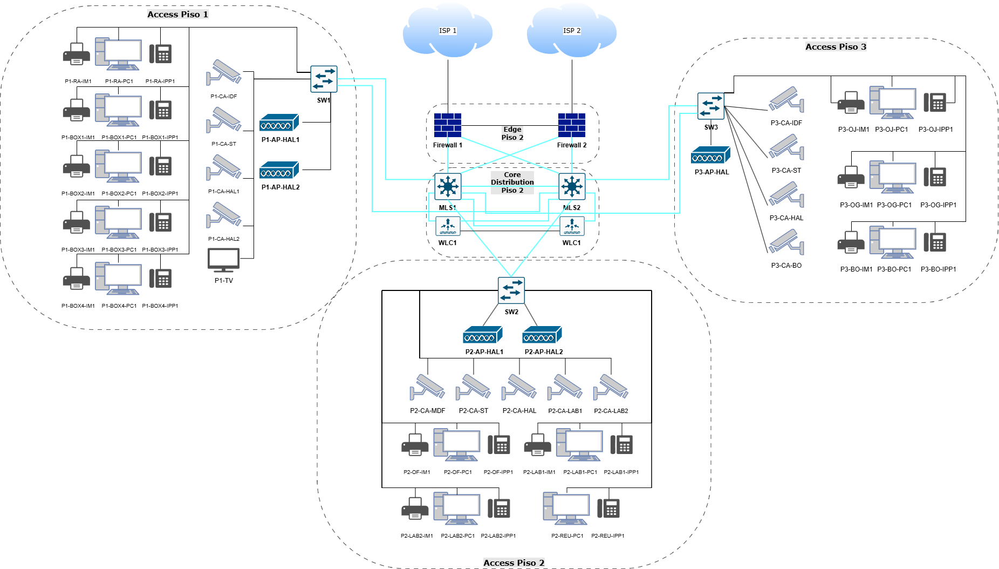
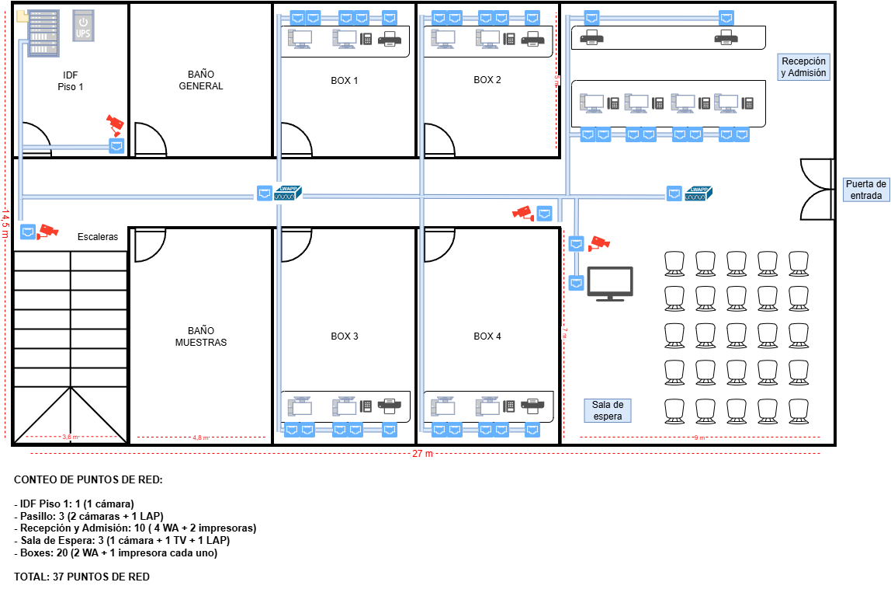
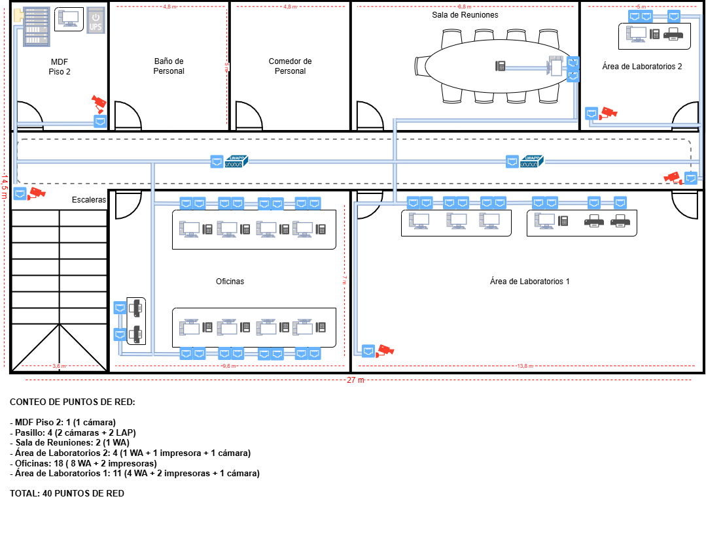
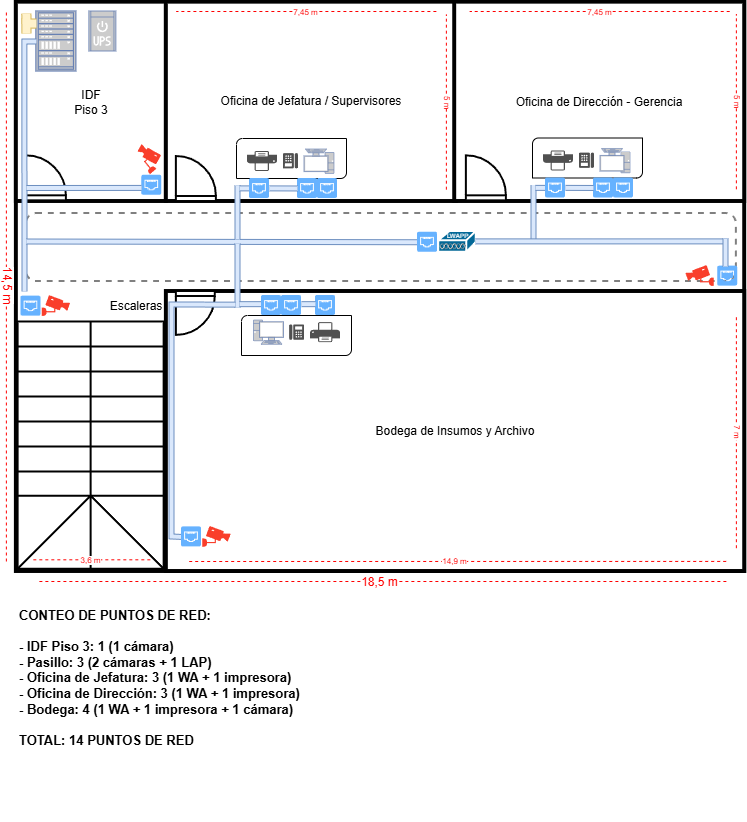

# 🏥 Infraestructura de Red y Comunicaciones Unificadas - Laboratorio Clínico INSI

## 📌 Resumen del Proyecto

Diseño e implementación de una arquitectura de red escalable, segura y automatizada para la nueva sucursal del Laboratorio Clínico INSI (1,050 m², 3 niveles). Desarrollado como proyecto de titulación, este trabajo se basó en requerimientos de un cliente real (obtenidos a través de personal de la empresa), aunque la ejecución y la interacción comercial fueron totalmente simuladas. Este proyecto resuelve la necesidad crítica de dotar a una instalación en obra gruesa de conectividad robusta, telefonía IP para la optimización de la atención, políticas de ciberseguridad para proteger datos médicos sensibles y automatización de tareas operativas para garantizar la continuidad del negocio.

## 🚀 Tecnologías y Protocolos

- Networking: Routing & Switching, IPv4 / IPv6, VLANs, OSPF, STP.
    
- Seguridad: Firewalls, ACLs, Port Security, segmentación de tráfico de pacientes vs. administración.
    
- Comunicaciones Unificadas: Telefonía IP (VoIP), QoS.
    
- Automatización: Ansible (Despliegue masivo y respaldo de configuraciones en equipos Cisco).
    
- Simulación: PNETLab.
    
- Equipamiento: Configuración y puesta en marcha de dispositivos Cisco y Fortinet.
    
## 🏗️ Arquitectura de la Red

El diseño físico y lógico abarca 3 pisos estructurados bajo normativas TIA, con más de 90 puntos de red activos:

  

- Piso 1 (Recepción, Boxes de Atención): 37 puntos de red. Alta disponibilidad para atención directa a pacientes.
    
- Piso 2 (Área de Laboratorios y Oficinas): 40 puntos de red. Segmentación estricta para asegurar la integridad de datos analíticos.
    
- Piso 3 (Dirección y Bodega): 14 puntos de red. Conectividad para sistemas de gestión administrativa.
    

## 🛡️ Enfoque en Ciberseguridad

El diseño e implementación de la seguridad se fundamenta en la alineación con los controles de la norma ISO 27001 y los principios de la Tríada C.I.A. (Confidencialidad, Integridad y Disponibilidad), abordando tres dimensiones críticas:

- Seguridad Lógica: Hardening exhaustivo en switches mediante asignación de VLAN Blackhole a puertos no utilizados, reasignación de la VLAN Nativa, deshabilitación de DTP (Dynamic Trunking Protocol) y segmentación de la administración a través de la VLAN 99 dedicada.
    
- Seguridad Física: Implementación de sistemas de videovigilancia y control de acceso en las salas IDF/MDF para auditoría de ingresos, respaldados por UPS Online de doble conversión para garantizar suministro continuo y protección eléctrica.
    
- Seguridad Operacional y Humana: Ejecución de planes de concientización y capacitación continua contra phishing e ingeniería social para el personal.
    

## ⚙️ Automatización (NetDevOps)

Para minimizar el downtime y evitar errores de configuración manual, se utilizaron playbooks de Ansible para el despliegue masivo y respaldo de configuraciones de equipos Cisco, lo que permite:

  

- Ejecución de respaldos automáticos de la configuración (Startup/Running config) de toda la infraestructura.
    
- Recuperación rápida ante desastres de equipos de red.
    

## 📊 Gestión y Dirección del Proyecto

La planificación y ejecución del proyecto se desarrollaron bajo un enfoque integral de gestión:

  

- Metodología Ágil (SCRUM): Organización del trabajo en sprints, entregas iterativas y reuniones de seguimiento para una rápida adaptación a los requerimientos.
    
- Estimación y Cálculo de Costos: Elaboración del presupuesto considerando adquisición de equipos de red, recursos humanos especializados y materiales de cableado estructurado.
    
- Definición de Roles de Trabajo: Asignación clara de responsabilidades técnicas, operativas y de liderazgo en el equipo.
    
- Gestión con el Cliente Simulado: Coordinación continua con los representantes del Laboratorio Clínico INSI para el levantamiento de requerimientos y validación de entregables.
    

## 🗺️ Topologías y Diagramas

A continuación se presentan los enlaces a la documentación gráfica y planos del proyecto:

  

- Piso 1:

   

- Piso 2:

   

- Piso 3:

    
- Topología Lógica Propuesta:

  

---

  

Desarrollado como Ingeniero de Proyecto de Redes - Proyecto Capstone de Ingeniería en Conectividad y Redes.

  

## 📁 Documentación Complementaria

El informe completo y detallado del proyecto se encuentra disponible en formato PDF en los archivos del repositorio.
